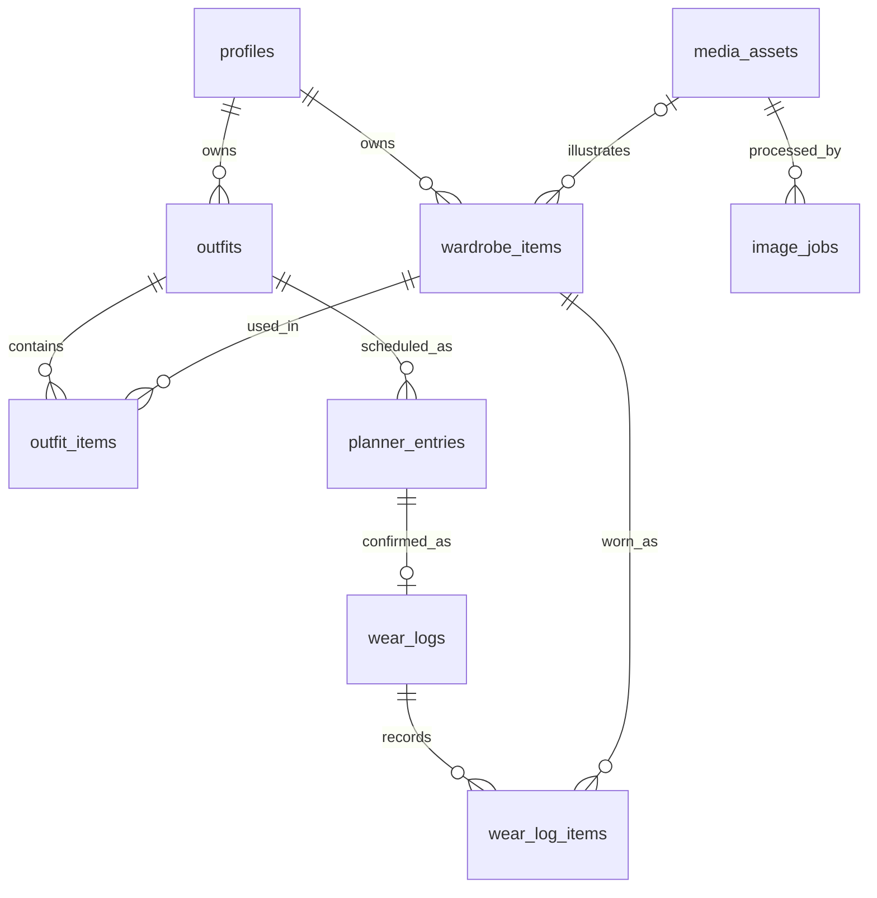

# Closet Loop — Mô hình dữ liệu

[Mục lục](../README.md) · Cập nhật: 11/11/2026

## Quy ước

- Khóa định danh dùng UUID; timestamp dùng `timestamptz`, lưu theo UTC.
- Ngày lịch/ngày mặc dùng PostgreSQL `date`, định dạng trao đổi `YYYY-MM-DD` theo múi giờ hồ sơ, mặc định `Asia/Ho_Chi_Minh`.
- Không chuyển ngày lịch thành nửa đêm UTC rồi suy ngược ở client vì có thể lệch ngày.
- Giá mua dùng số nguyên VND không âm, cho phép `NULL`; không dùng floating point để lưu tiền.
- Mọi dữ liệu riêng có `owner_id` hoặc được kiểm tra quyền qua bảng cha; `owner_id` không lấy từ payload để quyết định người sở hữu.
- Dùng FK, CHECK và UNIQUE cho ràng buộc; Pydantic kiểm tra dữ liệu trước khi ghi.

## Các bảng

| Bảng | Trường chính | Ý nghĩa/ràng buộc |
| --- | --- | --- |
| `profiles` | `id` → Auth user, `display_name`, `timezone`, mốc onboarding, `version`, timestamps | Một hồ sơ/tài khoản; [trường mở rộng](tai-khoan-va-cai-dat.md) |
| `media_assets` | `id`, `owner_id`, `staging_path`, `upload_expires_at`, `original_path`, `cutout_path`, `variant_metadata`, `status`, `created_at` | Lưu object path, không lưu signed URL; metadata kích thước/thumbnail cho từng bản ảnh; đường dẫn có thể rỗng trước khi hoàn tất upload |
| `wardrobe_items` | `id`, `owner_id`, `name`, `category`, `colors`, `size`, `brand`, `purchase_price_vnd`, `purchase_date`, `notes`, `source`, `asset_id`, `image_variant`, `availability`, `deleted_at`, timestamps | `source`: photo/placeholder; placeholder được phép chưa có asset; `image_variant`: original/cutout khi có ảnh |
| `outfits` | `id`, `owner_id`, `name`, `notes`, `style_tags`, `occasion_tags`, `version`, `deleted_at`, timestamps | `version` hỗ trợ phát hiện hai tab cùng sửa |
| `outfit_items` | `outfit_id`, `item_id`, `owner_id`, `x`, `y`, `w`, `h`, `z_index` | UNIQUE(outfit_id, item_id); tọa độ và kích thước chuẩn hóa |
| `planner_entries` | `id`, `owner_id`, `outfit_id`, `scheduled_date`, `event_label`, `status`, `outfit_snapshot`, `version`, `last_operation_key`, timestamps | Snapshot tên, mã món, asset/bản ảnh và bố cục tại lúc lên lịch; nhiều mục/ngày; version bắt đầu từ 1 |
| `wear_logs` | `id`, `owner_id`, `planner_entry_id`, `worn_date`, `created_at` | UNIQUE(planner_entry_id); một xác nhận cho một mục lịch |
| `wear_log_items` | `wear_log_id`, `owner_id`, `item_id`, `item_name_snapshot` | UNIQUE(wear_log_id, item_id); dữ liệu nguồn để tính lượt mặc |
| `image_jobs` | `id`, `owner_id`, `asset_id`, `request_key`, `status`, `error_code`, `started_at`, `finished_at` | UNIQUE(owner_id, request_key); theo dõi yêu cầu tách nền và chống gửi lặp |
| `account_deletion_requests` | `id`, `user_id`, `status`, `cleanup_manifest`, `requested_at`, `updated_at`, `finished_at` | Yêu cầu xóa bền vững, chỉ server được đọc/ghi; không cascade theo Auth user trước khi dọn xong |

`timestamps` gồm `created_at`, `updated_at`. `availability` gồm `available`, `laundry`, `unavailable`, `archived`. Chỉ bổ sung trạng thái `passed` khi làm Public Pass.

`media_assets.status`: `upload_pending`, `ready`, `rejected`. `image_jobs.status`: `processing`, `succeeded`, `failed`. Trạng thái AI độc lập với ảnh gốc đã hợp lệ.

Snapshot là JSON có schema và phiên bản, không phải JSON tùy ý. Server tạo snapshot từ dữ liệu đã kiểm tra quyền; không tin danh sách món hoặc đường dẫn ảnh client tự gửi.

Schema nền tảng ra mắt được tách riêng: [settings, consent và bản xuất](tai-khoan-va-cai-dat.md); [thông báo, hỗ trợ và audit](thong-bao-va-ho-tro.md). Các bảng này cũng phải có RLS/quyền trường và tham gia luồng xóa tài khoản.

`variant_metadata` có schema cho từng bản `original`/`cutout`: chiều rộng, chiều cao và thumbnail path. Chỉ cho chọn cutout sau khi có output hợp lệ. Snapshot lịch cố định cả `asset_id`, `image_variant` và metadata dựng ảnh tại thời điểm tạo; thay ảnh món sau này không đổi preview lịch cũ.

## Quan hệ chính

## Đọc tiếp

- [Transaction](transaction.md)
- [Vòng đời dữ liệu](vong-doi-du-lieu.md)
