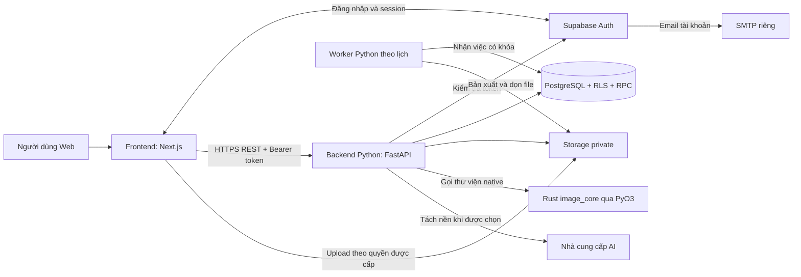

# Closet Loop — Kiến trúc tổng thể

[Mục lục](../README.md) · Cập nhật: 11/11/2026

**Đã chốt:** Web responsive trước, mobile app sau; frontend/backend tách riêng; backend dùng **Python + Rust**. Framework và cách tích hợp bên dưới là đề xuất.

## Công nghệ đề xuất

| Phần | Công nghệ | Trách nhiệm |
| --- | --- | --- |
| Frontend | Next.js App Router, React, TypeScript | Trang, form, Studio và UI responsive |
| UI | Tailwind CSS, shadcn/ui khi cần | Token giao diện, dialog, sheet và component |
| Form frontend | Zod | Phản hồi lỗi nhập liệu sớm |
| API backend | Python, FastAPI, Pydantic, Uvicorn | REST API, xác thực, nghiệp vụ và điều phối |
| Xử lý ảnh native | Rust, crate image | Kiểm tra/chuẩn hóa ảnh, loại metadata và thumbnail |
| Python–Rust | PyO3 và maturin | Đóng gói Rust thành thư viện Python `closet_loop_image_core` |
| Dữ liệu | PostgreSQL trên Supabase | Schema, RLS, transaction và truy vấn thống kê |
| Danh tính/ảnh | Supabase Auth, Storage private | Tài khoản, session và ảnh riêng |
| Email Auth | SMTP riêng nối Supabase Auth | Email xác minh/khôi phục/đổi email cho production |
| Công việc nền | Python worker/lịch host + bảng yêu cầu PostgreSQL | Xuất JSON, xóa tài khoản và dọn dữ liệu có lease/retry |
| AI tách nền | Nhà cung cấp bên ngoài do Python gọi | AI có quota, timeout và xác nhận của người dùng |
| Kiểm thử khi code | Vitest/Playwright; pytest; cargo test | UI, API/nghiệp vụ và phần Rust |
| Triển khai | Frontend riêng; Docker Python chứa wheel Rust; Supabase | Hai ứng dụng với cấu hình và build riêng |

FastAPI hỗ trợ chia ứng dụng bằng router/dependency và cung cấp hợp đồng OpenAPI. [Cấu trúc FastAPI](https://fastapi.tiangolo.com/tutorial/bigger-applications/), [OpenAPI](https://fastapi.tiangolo.com/features/).

PyO3 cho phép gọi thư viện Rust từ Python; maturin build thư viện thành wheel. [PyO3](https://pyo3.rs/), [maturin](https://www.maturin.rs/).

## Sơ đồ hệ thống

## Ranh giới

- Frontend gọi API nghiệp vụ. Supabase client frontend phục vụ Auth và upload theo quyền backend cấp.
- Python sở hữu nghiệp vụ, quyền truy cập, hồ sơ/cài đặt, dữ liệu cá nhân, thông báo/hỗ trợ, job AI và tác vụ nền.
- Rust nhận bytes ảnh và trả kết quả cho Python; quyền công khai, token, Storage và database do Python quản lý.
- Rust chạy trong tiến trình Python dưới dạng extension. Một API Python phục vụ Web và mobile tương lai.
- Ràng buộc nhiều bảng và lượt mặc nằm trong PostgreSQL RPC; frontend hiển thị kết quả đã lưu.
- RLS vẫn bảo vệ dữ liệu khi có người gọi trực tiếp Data API/RPC bằng JWT. [RLS Supabase](https://supabase.com/docs/guides/database/postgres/row-level-security).
- SMTP Auth do dịch vụ danh tính gửi; bản đầu không tự xây một dịch vụ gửi email nghiệp vụ. Nhân sự hỗ trợ dùng hộp thư vận hành thật.

## Phiên bản và phụ thuộc

- Chọn bản stable tương thích khi khởi tạo; pin Node/package manager cho frontend, CPython và Rust toolchain cho backend.
- Commit lockfile frontend, `backend/uv.lock` và `Cargo.lock`; kiểm tra wheel trên đúng OS/CPU/Python ABI.
- Dùng Supabase SDK và schema SQL; bổ sung ORM, Redis, queue ngoài hoặc shared package khi xuất hiện nhu cầu thực tế.
- Nhà cung cấp AI và hạn mức còn mở; nhập thủ công luôn là luồng sử dụng được.

## Đọc tiếp

- [Cấu trúc repository](cau-truc-repository.md)
- [Frontend](../frontend/cau-truc.md)
- [Python API](../backend/python-api.md)
- [Rust xử lý ảnh](../backend/rust-xu-ly-anh.md)
